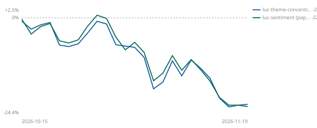

# 🏆 vibe-trade leaderboard

| # | Strategy | Return | Trend | As of | Days |
|---|---|---|---|---|---|
| 1 | luc-sentiment (paper) | -26.86% |  | 2026-11-25 | 41 |
| 2 | luc-theme-concentrated (live) | -28.91% |  | 2026-11-27 | 43 |

*Return = cumulative % since joining, on an Alpaca account (**paper** or **live**, labelled per row). Honor system — audit anyone's score via this repo's git history.*
